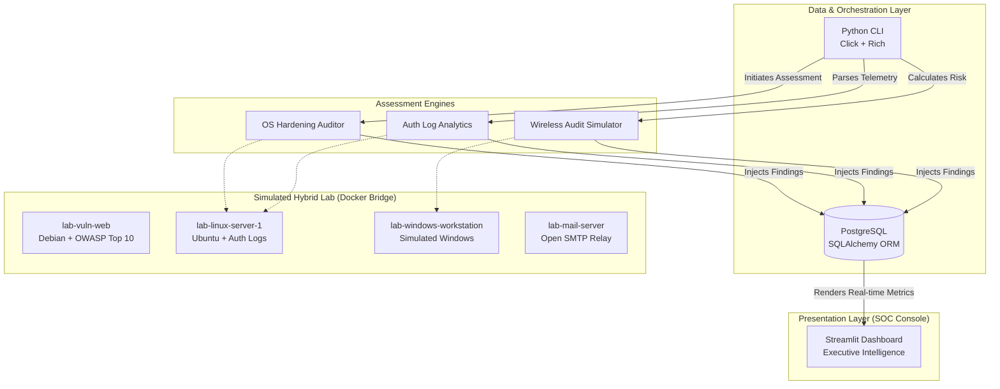

# 🛡️ Spec CTI: Academic Security Intelligence Platform


**Spec CTI** is an academic Security Intelligence platform developed for controlled laboratory environments. It focuses on vulnerability assessment, risk prioritization, executive reporting, and attack surface visualization. 

Architected to validate the detection and correlation of **OWASP** and **MITRE ATT&CK** vectors, it translates raw technical telemetry into actionable executive intelligence. It is not intended to replace commercial SIEM, EDR, or XDR solutions, but rather to demonstrate the full DevSecOps and Blue Team cycle.

---

## 🎓 Academic Alignment (Capstone Project)

This platform was developed as the comprehensive Capstone Project (Trabajo Fin de Curso) for the **IFCD072PO-CIBERSEGURIDAD, HACKING ÉTICO** certification. 

The architecture programmatically demonstrates proficiency across the 300-hour official syllabus[cite: 1], mapped as follows:

*   **Core Infrastructure:** The isolated hybrid Docker network demonstrates mastery of network architecture, Linux infrastructures, and Windows infrastructures.
*   **Reconnaissance & Telemetry:** Python-based CLI modules automate investigation methods, data collection, and scanning techniques and technologies across the simulated routers and gateways.
*   **Offensive Validation:** The platform's detection engines are built to identify and categorize vulnerability analysis, cyberattacks, password cracking attempts, Wi-Fi audits, exploits, and malware behaviors within the controlled environment.

The project was evaluated and validated under the academic supervision of *Soluciones y Aplicaciones Formativas VAL, S.L.* between April and July 2026.

---

## ⚠️ ETHICAL USE DISCLAIMER

> **This project is strictly for academic, educational, and portfolio purposes.**
>
> - All "victim" systems are fictional containers running inside an isolated Docker network provisioned by this repository.
> - The auditing, scanning, and exploit simulation modules operate **only** against the mock assets on this isolated network.
> - **Never** point any module, scanner, or analyzer at infrastructure you do not own or lack explicit written authorization to test.
> - By using this project, you agree you are executing it exclusively inside the sandboxed academic lab it provisions.

---

## 🏗️ Platform Architecture

Espec CTI operates on a decoupled architecture, separating the telemetry gathering (sensors) from the data layer and presentation.



## 📊 Dashboard Features

The Streamlit-based presentation layer mimics commercial SaaS security platforms, providing:

* **Dynamic Security Posture Score:** Real-time risk calculation (0-100) based on active critical and high-severity findings.
* **Compliance Tracking:** EU-focused regulatory mapping, tracking readiness for **ENS (Esquema Nacional de Seguridad)** and **RGPD / GDPR**.
* **Live Threat Feed:** Chronological ledger of security events with visual severity badges.
* **Attack Surface Profiling:** Interactive stacked charts mapping vulnerabilities directly to the affected hybrid assets.

## 🚀 Quick Start

Ensure you have Python 3.12+ and Docker Compose installed.

```bash
# 1. Clone the repository
git clone <your-fork-url> veredict-cti
cd spec-cti

# 2. Set up the virtual environment & install dependencies
python -m venv .venv
source .venv/bin/activate  # On Windows: .venv\Scripts\activate
pip install -r requirements.txt

# 3. Provision the hybrid laboratory environment
docker-compose up -d --build

# 4. Initialize the database schema and run the simulated assessment
python -m src.cli.main init-db
python -m src.cli.main demo-seed

# 5. Launch the Security Intelligence Platform (SOC Dashboard)
streamlit run src/monitoring/dashboard.py

```

## 🎯 Value Proposition for DevSecOps & Security Engineering

* **Risk-Based Prioritization:** Moves beyond raw CVSS scores by calculating environmental risk and translating technical flaws into executive summaries.
* **Software Engineering Best Practices:** Demonstrates decoupled architecture (ORM, modular CLI, isolated frontend), distinguishing it from traditional "script-kiddie" offensive tooling.
* **Compliance Integration:** Connects technical vulnerabilities (e.g., exposed SMTP) directly to business risk and regulatory compliance (ENS/RGPD).

---

*Spec CTI  — Academic Research Edition. © 2026 Fernando Silva.*

